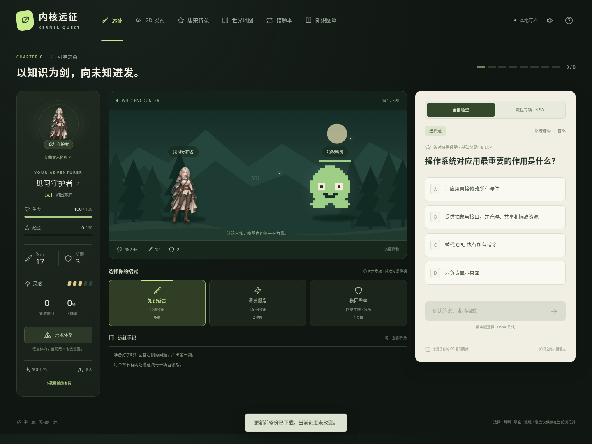
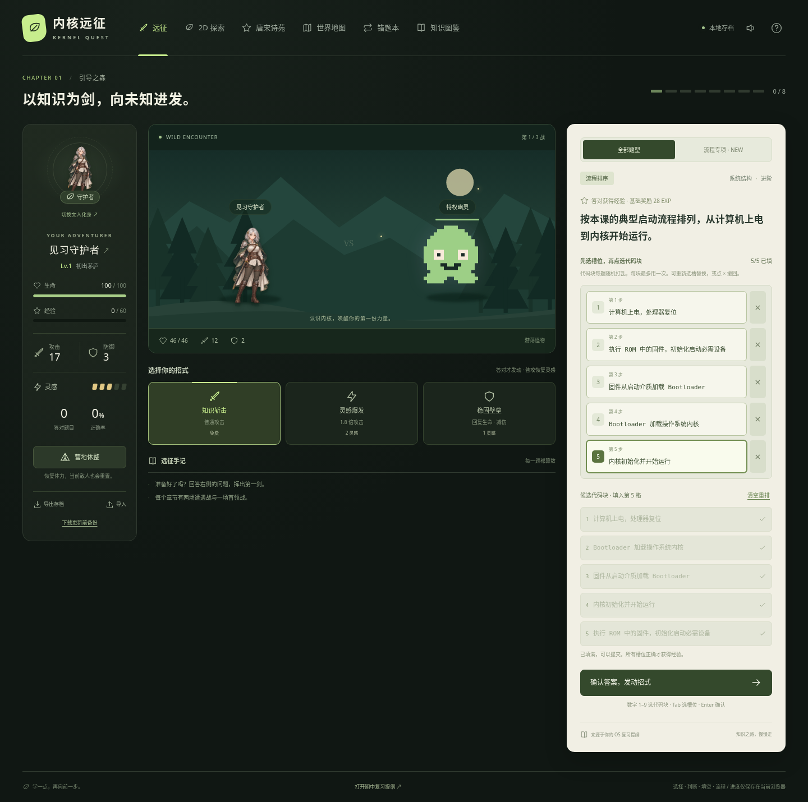
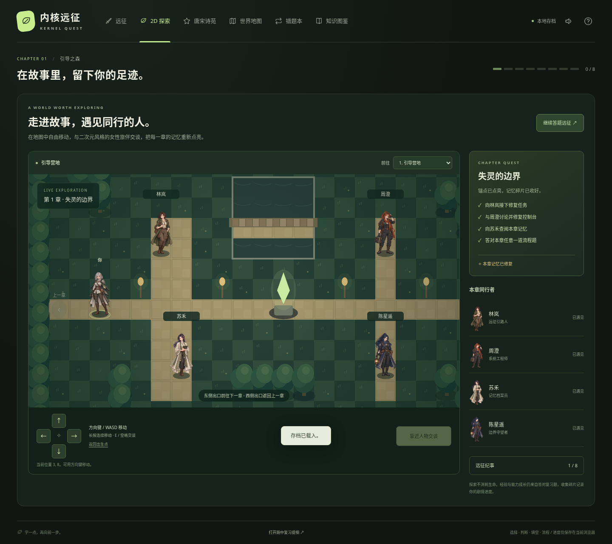
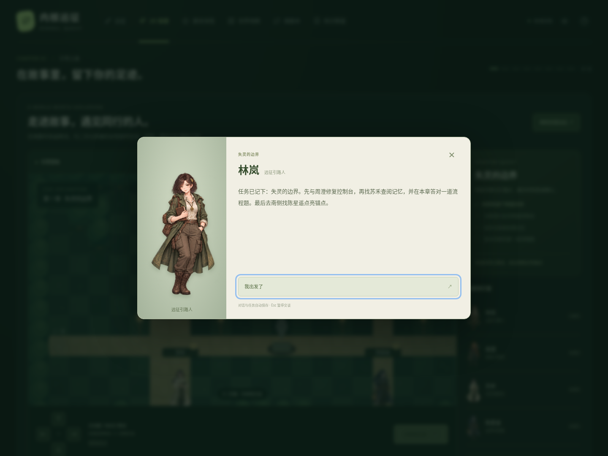
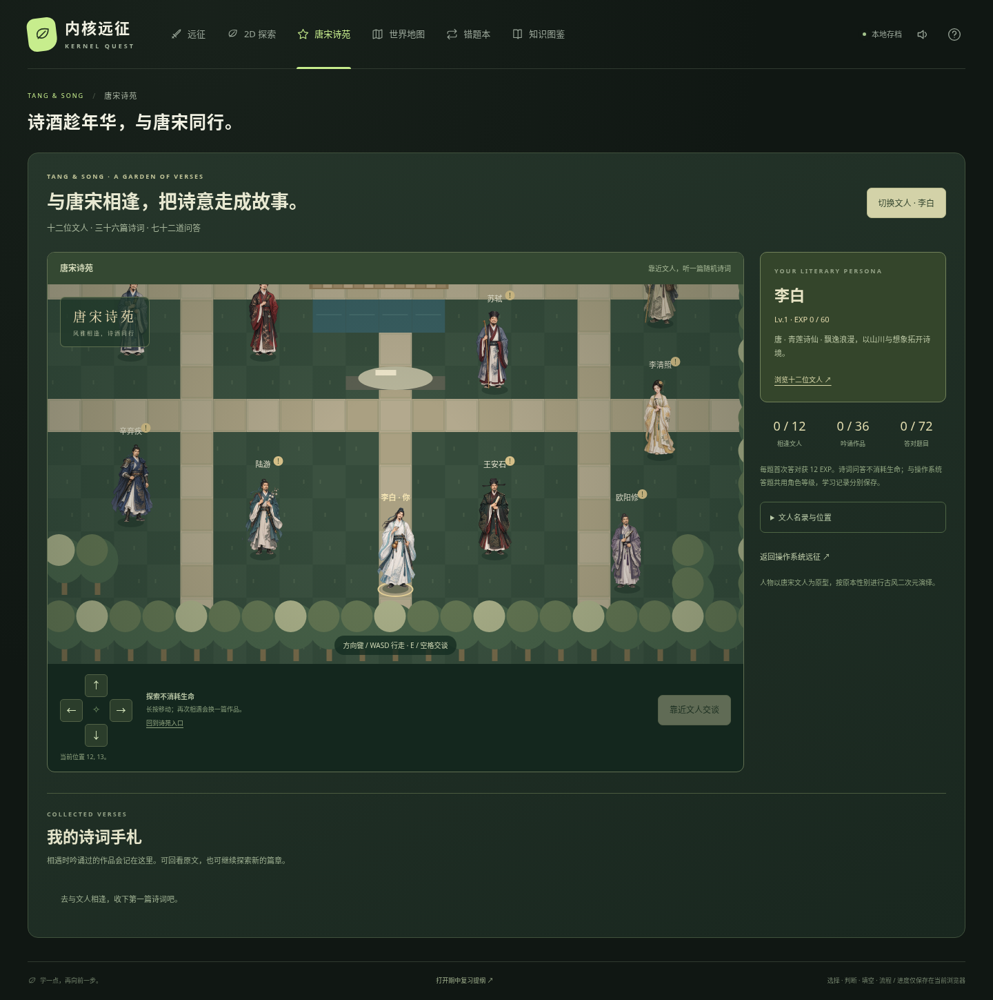
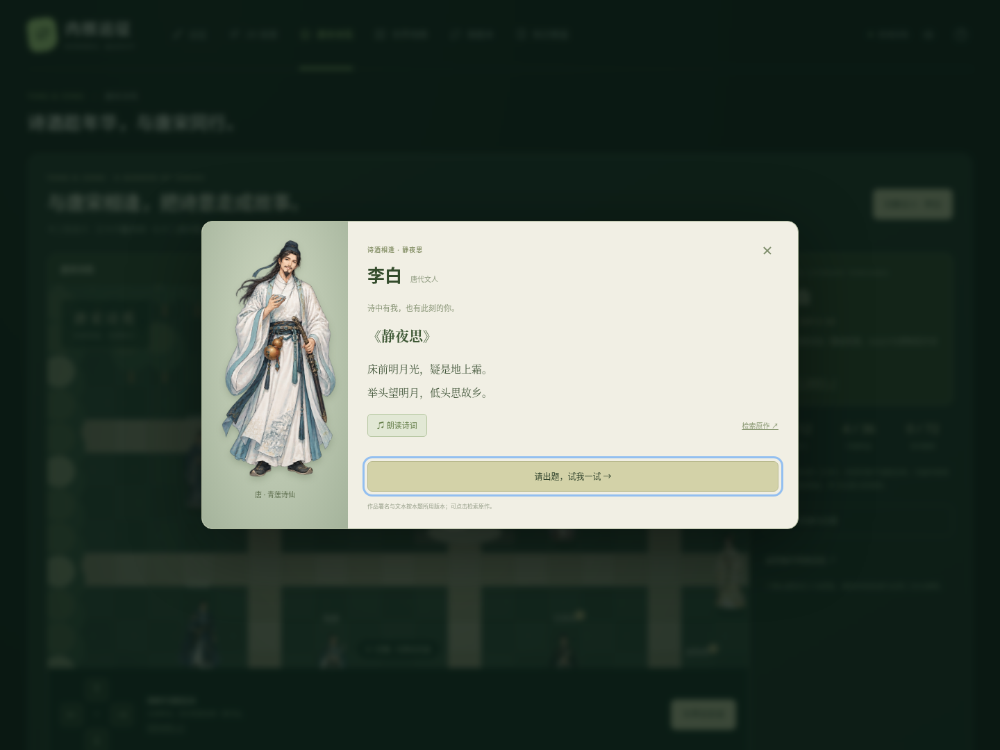

# 内核远征 · Kernel Quest

把操作系统复习与唐宋诗词变成一场冒险。操作系统答题驱动回合制战斗，诗苑中与文人吟诗问答；答对题目获得经验，升级提升攻击、防御和生命上限。













## 直接开始玩

下载本目录的 **[index.html](index.html)** 后，用现代浏览器打开即可。该文件包含全部样式、题库、画面和游戏代码，不需要安装依赖、不需要账户或后端，也没有外部字体/CDN 请求。题目来源链接会打开 GitHub 上的原课件，查看它们需要联网。

电脑与手机均适配。建议使用当前版本的 Chrome、Edge、Firefox 或 Safari。

## 在 GitHub 上打开游戏

GitHub 的文件页面通常展示 HTML 源码。要直接游玩，需要启用 **GitHub Pages**：

1. 打开仓库 **Settings → Pages**，将 **Source** 设为 **GitHub Actions**。
2. 打开 **Actions → Deploy OS Quest to GitHub Pages → Run workflow**，选择 `main` 并运行。
3. 工作流通过后，从该次运行的 `github-pages` 部署链接进入。

使用当前仓库默认项目站点配置，发布后的地址为 **https://zxymao.github.io/Chatgpt/**。只有工作流成功部署后，这个地址才会提供游戏。自定义域名时以部署输出地址为准。

发布流程在 [deploy-os-quest.yml](../../.github/workflows/deploy-os-quest.yml)。它会重新构建并测试游戏，只发布 `index.html`，不会将整个仓库一起放进网站。初次使用需在 Settings 中设置 Pages；此后推送到 `main` 的游戏目录或该工作流更新会自动触发发布，也可随时手动运行。其他目录的更新不会触发。此流程沿用该仓库的 Pages 根目录作为游戏入口；更新不会改变存档所在的网站地址。

## 玩法

- **八章冒险**：每章两场遭遇战加一场 Boss 战。击败章节首领后解锁下一章。
- **答题出招**：选择、判断、填空、流程混合出现。答对得到经验并发动招式；答错会受到更强反击，并展示答案和解析。
- **流程排序与代码填充**：先选槽位，再点击打乱的代码块；自动跳到下一空格。可点槽位替换、点 × 撤回，或清空重排。候选区可能含干扰块。全部位置正确才获得基础 28 EXP，答错会逐格标出对错并展示完整流程。答题区的 **流程专项** 可只练本章流程题，仍保留战斗与成长。
- **三种招式**：知识斩击免费，并恢复 1 点灵感；灵感爆发消耗 2 点、造成 1.8 倍攻击；稳固壁垒消耗 1 点、回复生命并降低本回合反击伤害。只有答对才发动、消耗灵感。
- **成长**：每次升级增加攻击、防御与生命上限，并恢复部分生命。击杀本身不额外授予经验，经验来源始终是答对题目。等级上限 50。
- **错题修炼**：无伤复习错题，答对获 10 EXP。连续答对两次后，从待复习列表移出。所有学习记录仍保留。
- **营地与战败**：休整恢复生命与 3 点灵感，同时重置当前敌人生命；战败不会丢失等级、经验、学习记录和解锁进度。
- **知识图鉴**：全部题目均可查阅答案、解析和原课件页码；章节“巩固数”表示连续答对两次的题目数，和是否击败 Boss 分别统计。
- **快捷键**：数字 1–4 选择答案，流程题 1–9 按候选区编号填块；填满后焦点移到确认按钮，Enter 提交。Tab 配合 Enter/空格也可选择槽位与代码块。填空支持大小写、全角英数字及空格归一化，并接受题库列出的等价写法。

没有时间限制。每次提交后先阅读解析，再进入下一回合，重复点击或刷新结算页不会重复发放经验。

## 2D 探索与 NPC 剧情

在顶部导航点击 **2D 探索**，进入可自由上下左右移动的地图。地图采用 Canvas 绘制，镜头跟随角色；树木、水池、记忆锚点和 NPC 有碰撞，桥梁可以通行。

- **电脑**：方向键或 WASD 移动，长按连续行走；靠近 NPC 后按 E / 空格，或点击“交谈”。Tab、Enter/空格也可操作方向按钮。
- **手机**：点按或长按地图下方的方向键，靠近后点“交谈”。
- **初次相遇**：第一次走到 NPC 身旁会自动触发问候。离开再回来不会重复弹出，也可以主动交谈。对话时移动暂停，Esc 或 × 可结束交谈。
- **区域旅行**：东侧出口前往下一章，西侧返回上一章，也可用区域下拉菜单旅行。区域沿用答题远征的章节解锁条件；地图探索不会消耗生命或重置当前敌人。

四位女性同行者与女性主角拥有统一的二次元立绘，出现在地图、对话、角色面板与战斗场景中。形象由图像生成工具创作，均为虚构成年女性角色。图片已内嵌到独立 HTML，离线打开时也能显示。角色外观与称呼更新沿用原 NPC 标识，已相遇记录、对话分支、任务、碎片和等级均继续保留。

| NPC | 互动与情节 |
|---|---|
| 林岚 · 远征引路人 | 介绍各章事件、提供背景分支、接受记忆锚点修复任务 |
| 周澄 · 系统工程师 | 提出系统规则问题；错误方案有解释与重试分支，正确方案修复控制台；可前往答题远征 |
| 苏禾 · 记忆档案员 | 阅读本章知识笔记，打开对应章节图鉴或错题本 |
| 陈星遥 · 边界守望者 | 核验修复记录，点亮锚点并收集本章记忆碎片 |

八章分别展开“失灵的边界、等待中的旅人、双塔的回声、被遗忘的队尾、熔炉前的竞态、环形等待之夜、消失的通知、星港的重复来信”。各章剧情与该章系统结构、进程、线程、调度、锁、死锁、同步、通信知识对应。

**任务流程**：找林岚接任务 → 帮周澄修复控制台 → 向苏禾查阅记忆 → 答对本章任意一道流程题 → 找陈星遥点亮锚点。已有的正确流程题记录可以作为证据。碎片只能领取一次，记录在“远征纪事”；经验和能力成长继续来自原有答题系统。NPC 的讨论分支推进剧情，不额外发放经验。

同章 NPC 的练习入口会切换到当前战斗的流程专项；探索其他已解锁区域时，会返回原来的答题远征。战斗结算尚未完成时，会先显示原结算页。原有等级、敌人、章节、错题与学习记录继续保留。

## 唐宋诗苑与可选文人主人公

顶部进入 **唐宋诗苑**，即可在独立的 2D 诗苑中遇见 12 位文人，无需先解锁操作系统章节。角色面板和诗苑入口均可点击 **选择主人公 / 切换文人化身**。12 位文人都可作为主人公，也可以保留原旅人形象；切换不重置等级、经验、生命、战斗、任务或学习记录。已经设置的个人昵称继续保留，默认昵称会显示所选文人的姓名。

文人按原本性别设计古风二次元形象：李白、杜甫等为男性，李清照为女性。立绘是以文学形象为原型的艺术演绎。所选形象会同步出现在角色面板、战斗、原 2D 地图与诗苑中。

| 文人 | 朝代 | 配置作品 |
|---|---|---|
| 李白 | 唐 | 静夜思、望庐山瀑布、早发白帝城 |
| 杜甫 | 唐 | 春望、绝句（两个黄鹂鸣翠柳）、望岳 |
| 王维 | 唐 | 鹿柴、山居秋暝、相思 |
| 孟浩然 | 唐 | 春晓、宿建德江、过故人庄 |
| 白居易 | 唐 | 赋得古原草送别、钱塘湖春行、问刘十九 |
| 杜牧 | 唐 | 山行、清明、泊秦淮 |
| 苏轼 | 宋 | 题西林壁、饮湖上初晴后雨·其二、水调歌头·明月几时有 |
| 李清照 | 宋 | 如梦令·常记溪亭日暮、夏日绝句、武陵春·春晚 |
| 辛弃疾 | 宋 | 西江月·夜行黄沙道中、破阵子·为陈同甫赋壮词以寄之、青玉案·元夕 |
| 陆游 | 宋 | 游山西村、示儿、卜算子·咏梅 |
| 王安石 | 宋 | 元日、泊船瓜洲、登飞来峰 |
| 欧阳修 | 宋 | 画眉鸟、采桑子·轻舟短棹西湖好、浪淘沙·把酒祝东风 |

每位配置 3 篇本人作品，共 **36 篇诗词、72 道题**，每篇包含一道填句题和一道诗意理解题。每次靠近文人会从其作品中随机选篇吟诵，优先未读作品，避免连续两次相同；离开后再相遇可触发新篇。地图名录中可以查看文人的位置。

先读原文，再点击 **请出题，试我一试**。可展开回看原文；提交后显示答案与解析。填句忽略标点、空格和全角字符差异。每题首次答对获 **12 EXP**，再次答对保留学习记录而不重复领取经验；答错不扣生命，也不攻击当前敌人。诗词与操作系统共用角色等级，正确率和学习记录分别统计。操作系统回合尚待结算时，要先完成结算，再开始诗词问答。

**朗读诗词** 使用浏览器和设备的中文语音，需主动点击；是否可用及声音效果取决于设备语音包，不依赖本项目的音频服务器。每篇提供原作检索链接；原文采用常见简体版本，存在异文时以题面为准，题库列明的等价写法也可接受。

**诗词手札** 收录已经吟诵的作品；相遇人数、已读篇数、答对题数分别统计。文人选择、诗苑坐标、当前吟诵篇目、题目、填写草稿、反馈结算和手札均支持刷新、导出与导入续玩。

## 题库范围

依据 [操作系统期中复习提纲](../复习资料/操作系统期中复习提纲.pdf)及老师的 10 份课件编写，共 **128 道原创复习题**，每章 4 道选择、4 道判断、4 道填空、4 道流程题。原有 96 道题的编号及内容全部保留。

| 章节 | 知识模块 |
|---|---|
| 引导之森 | 系统结构、特权级、系统调用、异常 |
| 进程遗迹 | PCB、地址空间、状态转换、进程 API |
| 线程双塔 | 线程共享、调度实体、并发与并行 |
| 调度旷野 | 调度算法、指标计算、优先级、实时调度 |
| 互斥熔炉 | 临界区、原子操作、锁、丢失唤醒、RCU |
| 死锁深渊 | 必要条件、银行家算法、安全状态 |
| 同步圣殿 | 信号量、条件变量、管程、屏障 |
| 通信星港 | 信号、管道、消息队列、共享内存、Socket |

少量拓展题在题干中标出“复习提纲拓展”。STCF/SRTCF 按本课件的非抢占/抢占命名区分；更正了安全检测 `Finish` 初值等容易混淆之处。每题有对应的原课件文件与 PDF 页码。

新增 32 道流程题包括：启动与系统调用、I/O 状态转换、fork/exec/wait、COW、线程创建与 join、丢失更新、FCFS/STCF/RR、Peterson/TAS/RCU、银行家安全性检测、生产者消费者、Mesa 条件变量、可复用屏障、管道、Socket、共享内存和消息重传。题干会给出必要的运行条件与指定次序；代码中的固定上下文无需填写，答案和解析也可在知识图鉴、错题本中查看。

## 存档

进度保存在当前浏览器的 `localStorage` 中。清除网站数据、更换浏览器、不同域名或 `file://` 与 Pages 之间切换，可能访问不到同一份存档。

用角色面板上的 **导出存档 / 导入** 迁移进度。导入需要确认，会替换当前进度；无效文件不会覆盖当前存档。浏览器禁止存储时仍可游玩，但离开前应手动导出。无需将存档上传到任何服务器。

### 本次更新如何保留进度

- 继续使用 `os-quest-v1` 存档键和版本 1 格式，保持原来的站点地址。旧版的角色名、等级、经验、生命、灵感、敌人生命、章节解锁、通关记录、错题与统计均继续读取，结算中的回合也保持锁定，不重复领奖。
- 诗苑新版首次读取有效旧存档时，在写入新版字段之前，将旧存档原文备份到 `os-quest-v1-before-poetry-update`；已存在的备份不会被覆盖。之前的 `os-quest-v1-before-world-update`、`os-quest-v1-before-flow-update` 备份也会保留。角色面板的 **下载更新前备份** 优先下载本次更新前的 JSON，下载本身不会回滚当前进度。需要回滚时可通过原有“导入”功能载入。
- 流程题的代码块排列、空槽、候选块顺序与当前槽位自动保存，刷新或切换招式后可以接着填。
- 地图区域、坐标、面向、已相遇 NPC、对话分支、任务和记忆碎片自动保存；刷新和导入后可以继续原来的探索视图与对话。旧存档缺少探索信息时从当前战斗章节的出生点开始，保留原战斗数据。
- 新增题目会扩大知识图鉴的巩固总数，不会撤销已经通过的章节或旧题记录。
- 诗苑题库单独存储，不改变原来的 128 道操作系统题编号、知识图鉴或错题记录；新增文人选择不会覆盖原昵称，也不会重置原有角色能力。

继续使用**原浏览器、原网站地址**即可读取原进度。更新前也可以手动导出一份备份；从本地 HTML 改到 Pages、换设备或换域名时，请导入该备份。仓库里的代码不包含玩家浏览器中的个人存档。

## 本地开发与测试

页面运行无需 Node。只有重新构建与测试需要 Node.js 22 或以上版本；无需执行 `npm install` 即可运行基础命令。

```bash
cd OS-course/os-quest
npm run build
npm test
```

`npm test` 执行 43 项引擎/题库/地图测试，包括完整 8 章通关、技能消耗、升级、错题移出、战败重试、坏存档、课件来源页码范围和刷新防重复奖励。流程测试覆盖全部 32 道题的完整/部分/错误输入、草稿恢复、干扰块、专项筛选及错题复习；地图测试覆盖碰撞、所有 NPC 与出口的可达性、初次与重复相遇、八章对话正误分支、完整任务、碎片防重复领取、旅行解锁与坏探索数据恢复。诗苑测试覆盖 12 位文人、36 篇本人作品、72 道题、随机选篇、首次答对奖励、结算锁、角色切换、全部文人可达性、草稿恢复和完整手札收集。

由原版提交 `fafd39d`、流程题版 `2cd281c` 和地图版 `14d99c4` 的未修改引擎生成固定存档，验证普通战斗、结算、复习、通关、部分流程草稿、NPC 对话和任务逐字段保留，并以散列校验原有题库内容未变。

本地 HTTP 预览可从仓库根目录运行：

```bash
python3 -m http.server 8000
```

浏览器访问 `http://localhost:8000/OS-course/os-quest/index.html`。也可直接打开 `index.html`。

浏览器端自动化测试是可选开发工具，需要环境中提供 Playwright 和 Chromium：

```bash
npm install --no-save --package-lock=false playwright
npx playwright install chromium
npm run test:browser
```

脚本优先使用 `/usr/bin/chromium`；可用 `CHROME_PATH` 指定其他浏览器程序。覆盖真实键盘答题、技能切换、错题复习、导入/导出、战败、通关、存档刷新、390px 手机布局及直接打开本地文件；同时测试旧存档就地升级、原始备份下载且不被覆盖、流程填充/替换/撤回/清空、部分草稿刷新恢复、逐格反馈、专项切换、触屏答题与防重复奖励。可用 `SCREENSHOT_DIR` 指定截图目录。

第二组浏览器测试会用真实按键和触屏走完一章任务：自动/主动交谈、错误与正确修复分支、答题返回、图鉴入口、记忆收集、原战斗数据不变、刷新和导入续玩、未解锁/已解锁出口、两代更新前备份共存，以及电脑/手机布局。

第三组浏览器测试验证文人选择和跨场景形象、旧地图存档升级、真实路径相遇、随机吟诵、中文朗读按钮、填句与选择题、经验和刷新防重复奖励、手札、导入续玩及手机触控。

本次云机器的受管 Chromium 策略禁止 `file://` 导航，因此该单项明确记为跳过；静态 HTTP 页面上的主要交互均已执行，并额外验证了阻断全部网络请求时，独立 HTML 仍可直接载入和渲染。脚本不会修改受管浏览器策略。

## 文件结构

```text
index.html           可直接运行的单文件发布版本
src/questions.js     128 道题及课件索引
src/engine.js        可独立测试的战斗、成长与存档逻辑
src/world.js         地形、移动、碰撞、对话树与八章任务
src/world-ui.js      Canvas 镜头、人物绘制、键盘/触屏与剧情交互
src/world.css        探索地图与 NPC 对话的响应式样式
assets/npc-cast.png  四位女性 NPC 与女性主角的透明二次元图集
src/poetry.js        唐宋文人、36 篇诗词、72 道题及诗苑状态
src/poetry-ui.js     诗苑地图、随机吟诵、朗读和诗词问答
src/poetry.css       文人选择、诗苑与诗词对话的响应式样式
assets/poets-*.png   按文人原本性别绘制的三组古风立绘
src/app.js           交互、像素画、存档与界面渲染
src/style.css        响应式界面与减少动态效果支持
src/template.html    页面模板
build.mjs            将源码打包成一个 HTML
tests/               规则测试与浏览器端测试
```

修改源码后运行 `npm run build`，并将更新后的 `index.html` 一起提交。游戏是本地单人学习工具，没有联网排名或多人服务器。
