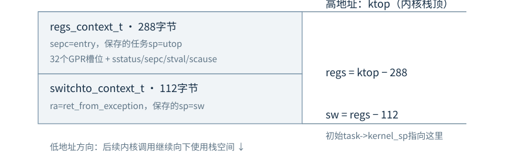

# prj1 → prj2 代码阅读提纲

你已经掌握期中提纲里的特权级、PCB、调度与同步。接下来要能沿着一条真实执行路径，说明**谁调用谁、此刻在哪个栈、哪些状态被保存、下一条指令从哪里开始**。

本文将实验一称为prj1、实验二A-Core称为prj2。源码依据为 `zxymao/Chatgpt` 的 `projects/Project2/`，版本为 `4d6cb77cd2ca`。prj2来自已校验的源码包；prj1依据仓库保存的实验一对照差异恢复，反向恢复后再正向应用，已核对与源码包一致。这里只规范化了文本换行。仓库里的 `os-lab/` 是另一套教学内核。

**先抓住两种执行模型。** prj1是“内核接收任务名 → 读入镜像 → 调用入口 → 任务返回 → 等待下个名字”。prj2是“预先加载多个任务 → 为每个任务建立PCB和栈 → 按事件保存当前执行流 → 恢复另一个执行流”。

## 建议按这六轮阅读

1. 第2—4页读prj1：搞清源码、ELF、磁盘镜像、内存中的任务四者的关系。
2. 第5—7页读prj2初始化：只跟第一个任务，画出它从PCB变成实际执行流的过程。
3. 第8页跟主动yield：手算A、B两次切换，特别注意各自的内核栈。
4. 第9页跟锁：让A持锁时yield，观察B为什么必须进入阻塞队列。
5. 第10—11页跟ecall：把用户库、异常入口、系统调用表、返回用户态串成一条线。
6. 第12—14页跟睡眠和时钟，再用自测题核对自己能否独立解释代码。

每次只读一个小节所列的文件。先写出函数的输入、共享状态和返回位置，再看函数体。能用两三个任务画出一次完整交错，比把所有头文件逐个读完更有用。

## 阅读时始终分清的五组对象

- `tasks[]` 是镜像任务元信息；`pcb[]` 才是运行时调度状态。
- `entrypoint` 是程序首次入口；`ra` 是函数返回地址；`sepc` 是异常返回位置。
- `switchto_context_t` 保存一次函数边界上的切换现场；`regs_context_t` 保存异常现场。
- `ready_queue` 决定哪些任务可运行；锁等待队列和 `sleep_queue` 存放暂时不能运行的任务。
- 库函数、内核函数、BIOS接口位于不同层；名字里出现 `sys_` 并不能单独证明发生了特权级切换。

配套的 **[源码索引.html](源码索引.html)** 收录两版完整文本，可搜索文件名或函数名。正文中的“P1/P2 文件:行号”链接直接定位到对应源码行；P1表示恢复出的实验一，P2表示归档中的实验二。

**完成目标：** 合上代码后，能画出“加载一个任务”“第一次运行一个任务”“一次yield”“一次锁阻塞”“一次时钟抢占”五条路径。

<!-- PAGE -->

## 1. prj1：先看构建出来的东西是什么

阅读入口：[P1 Makefile:1](源码索引.html#p1-makefile-L1)、[P1 tools/createimage.c:87](源码索引.html#p1-tools-createimage-c-L87)、[P2 tools/createimage.c:51](源码索引.html#p2-tools-createimage-c-L51)。

`Makefile` 先用RISC-V交叉编译器生成bootblock、内核和任务的ELF；镜像工具 `createimage` 则是运行在宿主Linux上的普通程序，用宿主GCC编译。二者的执行机器不同。

镜像工具读取ELF头和Program Header，把 `PT_LOAD` 中的文件数据写入镜像；ELF调试信息和文件头不是任务执行时要逐字加载的代码。`p_filesz` 表示文件中已有的数据，`p_memsz` 包含运行时还需要的内存；BSS的清零由启动代码完成。


bootblock只占第0扇区，内核从镜像字节偏移512开始。后续任务按实际文件跨度连续写入，因此任务起点不保证落在扇区边界上。prj2额外将镜像尾部补到扇区边界。

引导区尾部的四组信息是镜像工具与启动代码之间的共同协议：`0x1f6`存2字节任务数，`0x1f8`存4字节任务表字节偏移，`0x1fc`存2字节内核字节数，`0x1fe`存 `55 aa` 签名。bootblock装入 `0x50200000` 后，启动代码就在该基址加上述偏移的位置读取它们。

[P1 include/os/task.h:16](源码索引.html#p1-include-os-task-h-L16) 的 `task_info_t` 包含32字节名称、4字节offset、4字节size、8字节entrypoint，共48字节。**offset指磁盘镜像位置，entrypoint指执行地址，二者不能互换。**

prj1的 `write_segment()` 把各加载段的文件字节顺序写入。prj2的 `append_elf()` 则按 `p_vaddr−expected` 放置各段并填充中间空洞，保留相对地址布局。镜像工具的这项变化与调度算法无关，但会影响加载后的代码是否位于链接器预期地址。

本工程常见地址：bootblock为 `0x50200000`，内核入口为 `0x50201000`，任务从 `0x52000000` 起按 `0x10000` 分槽。任务放在不同槽位，并不自动等于有页表隔离。

**读完应能回答：** 为什么不能直接把完整ELF文件当机器指令运行？任务表为什么还要保存size和entrypoint？内核大小字段存的是字节数还是扇区数？

<!-- PAGE -->

## 2. prj1：从bootblock走进C函数

阅读顺序：[P1 arch/riscv/boot/bootblock.S:17](源码索引.html#p1-arch-riscv-boot-bootblock-s-L17) → [P1 arch/riscv/kernel/head.S:10](源码索引.html#p1-arch-riscv-kernel-head-s-L10) → [P1 init/main.c:50](源码索引.html#p1-init-main-c-L50)。

```text
课程固件 / U-Boot
  → bootblock 的 main
  → BIOS读磁盘，把内核装到0x50201000
  → head.S 的 _start：清BSS、建立sp
  → 内核 init/main.c 的 main(tasknum, app_info_offset)
```

bootblock先通过固定BIOS入口 `0x50150000` 打印和读盘。读内核时，a0是目标地址，a1是扇区数，a2是起始扇区1，a7是BIOS服务号。扇区数由 `(kernel_bytes+511)>>9` 向上取整。调用BIOS后，再把任务数放入a0、任务表偏移放入a1，最后 `jr` 跳到内核入口。

因此，同一个a0在不同调用点有不同含义。读代码要沿当前调用约定追踪，不能把某个寄存器永久理解成“任务号寄存器”。

这部分汇编先认清：`li`装入常数，`la`取符号地址，`ld/sd`读写64位内存，`call`写ra后跳转，`ret`按ra返回，`csrw`写CSR。`ld sp,...` 改变的是栈指针，不能理解成“把另一个任务的整块栈复制过来”。

`head.S` 处理C函数能成立的前提：关闭相关中断使能、用链接器符号定位BSS并清零、把sp设为启动栈，然后 `call main`。清BSS时使用t0/t1，保留了bootblock传入的a0/a1。prj1的 `bss_check()` 随后检查全局数组是否为零，是对启动工作的直接观察。

## 三个入口名相似，但职责不同

- `bootblock.S: main` 是引导块入口，负责装入内核。
- `kernel/head.S: _start` 是内核运行环境入口，随后调用内核C语言main。
- `crt0/crt0.S: _start` 是任务入口，清任务自身的BSS，再调用任务C语言main。

任务入口见 [P1 arch/riscv/crt0/crt0.S:4](源码索引.html#p1-arch-riscv-crt0-crt0-s-L4)。prj1的crt0保存ra和s0，清BSS后调用任务main；任务main返回时恢复ra/s0并返回加载器。它沿用当前执行流的栈，没有在这里创建可独立调度的任务栈。

**关键区别：** `call/jalr` 为通常的函数返回准备ra；`jr`只是跳转。内核给任务入口发起函数调用后，crt0必须维护这条返回路径，任务结束才会回到交互循环。这里还没有“任务结束后由调度器选择另一个PCB”的机制。

**动手画图：** 给bootblock、内核启动、任务crt0各画一个框，在跨框箭头旁标明“普通跳转 / 函数调用”，再标出a0/a1的含义。不要把课程BIOS服务号与后面prj2的系统调用号混为一张表。

<!-- PAGE -->

## 3. prj1：一个任务名如何变成正在运行的指令

核心入口：[P1 init/main.c:106](源码索引.html#p1-init-main-c-L106)、[P1 kernel/loader/loader.c:12](源码索引.html#p1-kernel-loader-loader-c-L12)、[P1 kernel/loader/loader.c:35](源码索引.html#p1-kernel-loader-loader-c-L35)。

交互循环从BIOS读取字符，把输入保存在 `taskname[]`；遇到回车补零，空输入重新等待。`load_task_img(taskname)` 遍历 `tasks[]` 比较名称，匹配后把指定镜像字节读到 `entrypoint`，然后返回入口地址。找不到时返回0，main打印错误后继续等待。

以下是实际执行点的源码节选：

```text
129          uint64_t entry=load_task_img(taskname);
130          if(entry==0){
131              bios_putstr("Task not found\n\r");
132              continue;
133          }
134          ((void (*)(void))entry)();
135          bios_putstr("\n\rTask finished, back to loader\n\r");
```

这里把整数入口地址转换成函数指针并调用。**只有一个执行流正在沿着这条调用链运行**：main的当前调用栈还在，任务返回后继续执行“Task finished”。存在多个任务镜像并不表示已经有多个可恢复的运行上下文。

## 跨扇区读取要跟一次具体数字

`load_img_bytes(offset,size,dst)` 每轮计算：所在扇区为 `offset/512`，扇区内偏移为 `offset%512`，本轮复制长度为 `min(512−偏移,size)`。先把整扇区读进临时buffer，再复制需要的字节，最后同时推进offset和目标指针，减少剩余size。

例如从镜像字节偏移1000读取600字节：第1轮从扇区1的偏移488处复制24字节；第2轮从扇区2复制512字节；第3轮从扇区3复制64字节。最终恰好读取600字节。这里的24、512、64是阅读示例，不是程序固定的任务大小。

`tasks[]` 本身也通过这个函数读入，因此任务表同样可以从非扇区边界开始。prj2仍保留此思路，并在任务代码加载完成后执行 `fence.i`，使随后取指能看到刚写入的代码。

## 把printf下面的层次先分清

prj1的 `bios_putstr → call_jmptab` 根据固定跳转表中的函数指针调用内核包装函数，包装函数再进入课程BIOS。参见 [P1 tiny_libc/include/kernel.h:12](源码索引.html#p1-tiny_libc-include-kernel-h-L12) 和 [P1 arch/riscv/bios/common.c:7](源码索引.html#p1-arch-riscv-bios-common-c-L7)。这是函数指针间接调用；不能把它直接当成“用户态ecall陷入内核”。

**读完应能独立复述：** 谁填写 `tasks[]`？从名称找到入口需要哪四项信息？任务为何能返回加载器？把offset错误地当成内存地址会在哪一层出错？

<!-- PAGE -->

## 4. prj2：从单任务调用改成多任务启动

先读 [P2 Makefile:14](源码索引.html#p2-makefile-L14)、[P2 init/main.c:188](源码索引.html#p2-init-main-c-L188)，再按下面顺序展开函数体。

```text
main
 → init_jmptab → init_task_info → init_pcb
 → 读取time_base → init_locks → init_syscall
 → init_exception → init_screen
 → 阶段4设置timer、使能STIE → idle循环中的do_scheduler
```

prj2启动时把选定的任务都加载好并加入就绪队列，不再等待用户逐个输入任务名。`init_task_info()` 检查任务数、名称终止符、入口槽位和大小；`init_pcb()` 才进一步为任务分配运行时资源。

阶段开关会改变执行路径，跟代码前先看编译时的 `LAB_STAGE`：

| 阶段 | 任务方式 | 主要切换来源 | 首先跟读的测试 |
|---|---|---|---|
| 1 | S模式，服务经跳转表 | 主动yield | `coop1/coop2` |
| 2 | S模式，服务经跳转表 | yield及锁阻塞 | `mutex1/mutex2` |
| 3 | U模式，服务经ecall | yield、阻塞和睡眠 | `sleep/coop_timer` |
| 4 | U模式，服务经ecall | 加上时钟抢占 | `probe1/probe2` |

上表是本仓库A-Core版本的实现安排。Task1/2、完整Task3、Task4在同一份源码中用条件编译区分；预处理后的机器代码只包含当前阶段的分支。默认阶段是4。

`init_pcb()` 的单任务初始化顺序为：清PCB → 分配pid → 标READY → 初始化链表节点 → 分配一页内核栈及一页用户栈 → 加载任务 → 构造初始栈 → 进入ready_queue。见 [P2 init/main.c:146](源码索引.html#p2-init-main-c-L146)。

内存分配器见 [P2 kernel/mm/mm.c:6](源码索引.html#p2-kernel-mm-mm-c-L6)：它只是将当前位置按4096字节对齐并向前推进。这里的“用户页/内核页”是两段分配区域，不代表已经建立不同页表；本工程没有完整的地址空间隔离、回收式页分配器或SMP调度。

**这一页只需形成一个判断：** prj1读入任务后立刻调用入口；prj2读入任务后先放进“能在未来被恢复”的状态，真正开始执行要等调度和汇编恢复路径。

<!-- PAGE -->

## 5. PCB、链表与三个队列不变量

阅读入口：[P2 include/os/sched.h:38](源码索引.html#p2-include-os-sched-h-L38)、[P2 include/os/sched.h:65](源码索引.html#p2-include-os-sched-h-L65)、[P2 include/os/list.h:43](源码索引.html#p2-include-os-list-h-L43)。

`tasks[i]` 描述磁盘里有什么；`pcb[i]` 描述现在执行到什么状态。PCB中的核心字段应按“被谁使用”理解：

- `kernel_sp`：汇编恢复该任务内核执行现场时要取出的栈位置。
- `user_sp`：U态陷入时记录用户栈指针；返回时仍须恢复原用户sp。
- `trap_t0`：异常入口最早借用t0之前的临时保存位置。
- `user_stack_base`：栈区域边界，也用于本版本的输出指针检查。
- `list`与`status`：队列操作和调度选择共同维护运行资格。
- `pid`、`cursor_x/y`、`wakeup_time`：身份、屏幕位置和睡眠截止tick。

`current_running` 不是普通全局指针，它绑定到RISC-V的tp寄存器。S模式的内核按该约定使用tp；阶段3/4进入U态后，用户自己的tp可以不同。因此异常入口还需要 `sscratch` 帮助重新找到PCB，不能在任意特权级都把tp当成PCB。

## 链表不是“PCB指针数组”

每个PCB内嵌一个 `list_node_t`。空链表的头节点指向自己；脱链的PCB节点也初始化为自环。`list_entry(node,pcb_t,list)` 减去成员偏移，从节点地址还原整个PCB。`list_del()` 删除后重新初始化节点，便于后续判断它是否已经脱链。

跟读 [P2 include/os/list.h:53](源码索引.html#p2-include-os-list-h-L53) 的五个小函数：`list_init`、`list_empty`、`list_add_tail`、`list_del`、`list_pop_front`。先手画一个头节点和A、B两个PCB节点，再执行一次“弹出队头，追加队尾”。

## 读调度代码时不断核对

1. 运行中的普通任务已从ready_queue取出，不应同时还在该队列中。
2. 阻塞任务的同一个list节点只挂在某一个等待队列中；它不能同时在就绪队列和锁等待队列里。
3. `do_unblock()` 只把BLOCKED改成READY并加入队尾，不承诺马上执行该任务。

pid0有单独PCB，负责启动及idle，不与普通任务一样每次回到就绪队列。`TASK_EXITED` 虽然存在于枚举中，本版本没有实现完整的进程退出系统调用。

**自查：** 如果只改status、不移动链表，会发生什么？如果只把B从锁队列摘掉、却没加入ready_queue，B还能被调度到吗？

<!-- PAGE -->

## 6. 新任务第一次执行：先构造一个可以恢复的栈

阅读入口：[P2 init/main.c:124](源码索引.html#p2-init-main-c-L124)、[P2 arch/riscv/include/asm/regs.h:85](源码索引.html#p2-arch-riscv-include-asm-regs-h-L85)、[P2 arch/riscv/kernel/entry.S:167](源码索引.html#p2-arch-riscv-kernel-entry-s-L167)。

新任务从未进入过异常处理，也从未调用过 `switch_to()`。初始化代码就预先构造两种现场，让后续通用恢复代码能够把它启动起来。



288字节的 `regs_context_t` 包含32个通用寄存器槽位和4个CSR槽位；112字节的 `switchto_context_t` 包含ra、sp、s0—s11。两者都位于该任务的内核栈中，但代表不同层次的恢复状态。

`regs->regs[2]=utop` 设置恢复后的任务sp，`regs->sepc=entry` 设置首次执行位置。阶段3/4设置 `sstatus=SR_SPIE`，SPP为0，因此sret进入U模式；阶段1/2设置SPP，恢复到S模式，并在保存的tp槽位放入PCB地址。

下面四行把切换现场接到异常返回现场上：

```text
140      sw->regs[0] = (ptr_t)ret_from_exception;
141      sw->regs[1] = (ptr_t)sw;
142      task->kernel_sp = (ptr_t)sw;
143      task->user_sp = utop;
```

第一次启动任务的路径因此是：

```text
do_scheduler选中该PCB
 → switch_to加载它的kernel_sp，恢复初始切换帧
 → ret跳到ret_from_exception
 → RESTORE_CONTEXT恢复预制异常帧
 → sret使用sepc/sstatus进入任务crt0
 → crt0清BSS，再call用户main
```

**首次启动的位置由sepc控制，不是靠直接call任务入口。** 参见 [P2 arch/riscv/crt0/crt0.S:3](源码索引.html#p2-arch-riscv-crt0-crt0-s-L3)：prj2的任务main如果意外返回，crt0会反复 `sys_yield()`，因为这里不存在prj1那样真实的加载器调用者。

图只表示新任务的初始布局。任务在内核调用链中再次被切走时，`kernel_sp` 会指向当前更深位置的切换帧；不能把它永久理解成固定栈顶或固定288字节帧地址。结构偏移的 `_Static_assert` 正是为了让C布局与汇编约定一致。

<!-- PAGE -->

## 7. 一次yield：选择下一个任务，再真的换栈

先读 [P2 kernel/sched/sched.c:16](源码索引.html#p2-kernel-sched-sched-c-L16)，再读 [P2 arch/riscv/kernel/entry.S:130](源码索引.html#p2-arch-riscv-kernel-entry-s-L130)。

`do_scheduler()` 保存中断状态并关本地中断，先检查到期睡眠者。当前普通任务仍为RUNNING时，将它改为READY并放到队尾；已BLOCKED的任务不回就绪队列。随后弹出队首作为next，队列为空则选择pid0；只有 `prev!=next` 才调用汇编切换。

假设A正在运行、队列中只有B：A yield时先把自己排到B之后，弹出B，于是B运行而队列只剩A。B再次yield后，A又被选中。这是FIFO轮转，不是每次扫描所有PCB并凭pid大小选择。

`switch_to(prev,next)` 中最关键的片段如下，中间省略部分同类寄存器读写：

```text
130  ENTRY(switch_to)
131      addi sp, sp, -SWITCH_TO_SIZE
132      sd ra, 0(sp)
133      sd sp, 8(sp)
134      sd s0, 16(sp)
135      sd s1, 24(sp)
    …
146      sd sp, PCB_KERNEL_SP(a0)
147      mv tp, a1
148      csrw CSR_SSCRATCH, tp
149      ld sp, PCB_KERNEL_SP(tp)
150      ld ra, 0(sp)
151      ld s0, 16(sp)
    …
163      ld sp, SWITCH_TO_SP(sp)
164      addi sp, sp, SWITCH_TO_SIZE
165      ret
166  ENDPROC(switch_to)
```

注意切换发生的分界：把旧sp写入prev的PCB后，tp改指向next，sp改为next的栈。之后恢复的ra属于next，最后的ret自然回到next保留的返回位置。

## 为什么只保存这14个寄存器

这里的汇编入口是C调用约定中的普通函数边界，ra、sp和callee-saved的s0—s11足以维护这种内核调用链的恢复；caller-saved寄存器由正常调用约定处理。发生U态异常或异步中断时，原任务任意时刻的通用寄存器则先由完整异常帧保存，不能只靠这112字节。

## 为什么“返回”后像进入了另一个函数

A第一次切到B时，如果B曾经运行过，B恢复的是**自己上一次切出时的调用栈**，于是从自己的 `switch_to()` 调用后继续，完成自己的 `irq_restore(flags)`，再层层返回。A的局部变量和返回链仍留在A的栈里，等A未来被选中后才继续执行。新任务则走上一页的特殊首次返回路径。

**纸上跟读：** 画A和B两列，每列依次写 `sys_yield → do_scheduler → switch_to`。把两次“恢复另一个sp”的位置连起来，再标出哪一个任务最终执行哪一个ret。能画对这张图，就理解了上下文切换的核心。

<!-- PAGE -->

## 8. Task2的锁：先睡下，再接收所有权

阅读入口：[P2 kernel/locking/lock.c:30](源码索引.html#p2-kernel-locking-lock-c-L30)、[P2 kernel/locking/lock.c:53](源码索引.html#p2-kernel-locking-lock-c-L53)、[P2 kernel/locking/lock.c:67](源码索引.html#p2-kernel-locking-lock-c-L67)，再联读 [P2 kernel/sched/sched.c:51](源码索引.html#p2-kernel-sched-sched-c-L51) 和 [P2 kernel/sched/sched.c:62](源码索引.html#p2-kernel-sched-sched-c-L62)。

`sys_mutex_init(key)` 返回锁槽位下标。同一个key复用同一把锁，不是每次调用都分配新锁。每把锁同时保存status、owner及一个等待队列；它们分别回答“是否占用”“谁持有”“还有谁在等”。

获取锁先做一次原子try-acquire。成功则记录当前pid为owner；失败则调用 `do_block()`，把自己标记BLOCKED、放入该锁的等待队列，再调度其他任务。底层虽有自旋锁辅助接口，**这个mutex的竞争失败路径是阻塞，不是一直循环抢锁**。

## 跟一次会真正发生竞争的交错

1. A获取锁，owner=A，锁状态为LOCKED。
2. A在临界区内主动yield。A仍持锁，只是暂时不运行。
3. B运行并获取同一把锁失败。B进入锁等待队列，状态BLOCKED，不回ready_queue。
4. A恢复并释放锁。释放函数先把owner直接设为队首B，再调用 `do_unblock(B)`；锁仍保持LOCKED。
5. B以后被调度回来，沿自己原来的 `do_block()` 返回，检查owner确为自己，然后继续临界区。

释放代码的关键分支是：

```text
 72      if (!list_empty(&lock->block_queue)) {
 73          list_node_t *node = lock->block_queue.next;
 74          lock->owner = list_entry(node, pcb_t, list)->pid;
 75          do_unblock(node); /* lock remains LOCKED until this owner releases */
 76      } else {
 77          lock->owner = 0;
 78          spin_lock_release(&lock->lock);
 79      }
```

这是一种**所有权直接移交**。有等待者时不先把锁改成UNLOCKED，所以新来的C不能在B真正获得CPU前把锁抢走。没有等待者时才清owner并真正解锁。

`do_unblock()` 的工作只是从等待队列摘除B，标READY，再放入就绪队尾；它没有立即执行B，也没有自行决定锁归谁。锁的owner由释放函数先设置好，两层职责要分开。

阅读 [P2 test/validation/mutex1.c:8](源码索引.html#p2-test-validation-mutex1-c-L8)。测试特意在持锁期间yield，才能让另一任务在阶段2的非抢占环境下进入竞争路径。如果两个任务总是“拿锁 → 做完 → 放锁 → 最后才yield”，屏幕交替并不能证明阻塞队列实现正确。

本版本不支持递归获取；无效锁号、非owner释放等会触发断言。队列和锁状态修改由本地关中断包围，这是单核实现的前提，不能据此推导多核上也已经安全。

<!-- PAGE -->

## 9. Task3的系统调用：沿一次sys_write走到底

阅读顺序：[P2 tiny_libc/syscall.c:6](源码索引.html#p2-tiny_libc-syscall-c-L6) → [P2 arch/riscv/kernel/entry.S:171](源码索引.html#p2-arch-riscv-kernel-entry-s-L171) → [P2 kernel/irq/irq.c:15](源码索引.html#p2-kernel-irq-irq-c-L15) → [P2 kernel/syscall/syscall.c:3](源码索引.html#p2-kernel-syscall-syscall-c-L3) → [P2 init/main.c:34](源码索引.html#p2-init-main-c-L34)。

```text
用户printf在自己的栈里格式化字符串
 → sys_write → invoke_syscall：参数a0…a4，调用号a7
 → ecall：硬件转入stvec所指的S态入口
 → exception_handler_entry：SAVE_CONTEXT，传入异常帧指针
 → interrupt_helper：按scause分派到handle_syscall
 → syscall[number] → k_write → screen_write
 → 返回值写到异常帧的a0槽位
 → RESTORE_CONTEXT → sret → 用户ecall之后继续
```

这里的 `regs->regs[17]` 是保存的a7，`regs->regs[10]` 是保存的a0。`handle_syscall()` 的实现很短，但要能解释每一行：

```text
  6      uint64_t number = regs->regs[17]; /* a7 */
  7      regs->sepc += 4; /* ecall is always a 32-bit instruction */
  8      if (number >= NUM_SYSCALLS || !syscall[number]) {
  9          regs->regs[10] = (reg_t)-38; /* ENOSYS */
 10          return;
 11      }
 12      regs->regs[10] = syscall[number](regs->regs[10], regs->regs[11],
 13                                      regs->regs[12], regs->regs[13], regs->regs[14]);
```

系统调用表在 [P2 init/main.c:173](源码索引.html#p2-init-main-c-L173) 初始化。不是所有编号都有实现；超出表界或空表项都返回 `-38`。输出字符串的 `k_write()` 先验证完整字符串位于当前任务的镜像槽或用户栈中并找到终止符，不符合时返回 `-14`。这些检查不等于已经建立页表级内存隔离。

## 三张“表/入口”分别解决什么

**内核跳转表**位于固定地址，早期阶段用函数指针直接调用服务。**系统调用表**是内核里的 `syscall[]`，阶段3/4先经ecall和异常分派，才索引到它。**BIOS入口**是课程固件提供的固定接口，内核用它做磁盘、定时器、串口等底层操作。

同一个 `sys_write()` 在阶段1/2走 `call_jmptab()`，在阶段3/4才走 `invoke_syscall()`。阅读时打开对应的 `#if LAB_STAGE` 分支；不要因为函数名没变，就假定两个阶段的权限边界也相同。

如果一次系统调用内部阻塞，当前任务会连同尚未返回的内核调用栈一起暂停。恢复后继续完成处理，最终通过原异常帧返回用户态；并不会从用户程序main重新开始。

<!-- PAGE -->

## 10. 异常入口：tp、sscratch和两种现场

聚焦 [P2 arch/riscv/kernel/entry.S:8](源码索引.html#p2-arch-riscv-kernel-entry-s-L8) 的 `SAVE_CONTEXT`、[P2 arch/riscv/kernel/entry.S:70](源码索引.html#p2-arch-riscv-kernel-entry-s-L70) 的 `RESTORE_CONTEXT`，以及 [P2 arch/riscv/kernel/trap.S:3](源码索引.html#p2-arch-riscv-kernel-trap-s-L3) 的入口安装。

硬件把异常返回位置和原因等写入CSR并按stvec跳入S态，但不会替这份内核自动保存全部通用寄存器，也不会自动把用户sp换成本工程的内核栈。这些工作由entry.S完成。

## 先跟这五个动作，别一开始就背全部sd/ld

1. `csrrw tp,sscratch,tp`：原sscratch里的PCB进入tp；原用户tp暂存在sscratch中。
2. 把原t0先存到PCB的 `trap_t0`，再读取sstatus的SPP位，判断异常来自U态还是S态。
3. 来自U态则保存用户sp，从PCB取内核sp；来自S态则沿用当前S态栈。随后减288字节建立异常帧。
4. 保存其余寄存器和CSR；从sscratch取回原tp写入异常帧，再把sscratch恢复成PCB地址。
5. a0传异常帧指针，a1/a2传stval/scause，调用C函数 `interrupt_helper()`。

入口最早的几行是：

```text
  8  .macro SAVE_CONTEXT
  9      csrrw tp, CSR_SSCRATCH, tp
 10      sd t0, PCB_TRAP_T0(tp)
 11      csrr t0, CSR_SSTATUS
 12      andi t0, t0, SR_SPP
 13      bnez t0, 1f
 14      sd sp, PCB_USER_SP(tp)
 15      ld sp, PCB_KERNEL_SP(tp)
 16  1:  addi sp, sp, -OFFSET_SIZE
```

`RESTORE_CONTEXT` 恢复sstatus和sepc，更新PCB中可供下次U态陷入使用的内核栈位置，再恢复通用寄存器。最后才恢复原tp和原sp，因此恢复前仍能使用内核PCB及异常栈。紧随其后的 `sret` 按CSR内容返回相应特权级。

## 用三个问题区分容易混淆的现场

**“用户刚才执行到哪？”** 看异常帧中的sepc。**“内核调用链以后从哪继续？”** 看切换帧保存的ra和sp。**“这是哪个任务的现场？”** 看当前PCB与它指向的内核栈。这三者互相配合，不能只看一个入口地址。

ecall是同步的服务请求，返回时应越过已执行的32位ecall，所以 `sepc+=4`。时钟是异步打断，没有一条“请求指令”需要跳过，不能照抄这个加4。`interrupt_helper()` 通过scause的中断标志位区分两张分派表，定时器处理器不会修改sepc。

**自测：** 若用户把tp改成一个普通数值，异常入口为何仍能找到PCB？若只保存ra/sp，不保存a0—t6，时钟打断任意计算会出现什么问题？

<!-- PAGE -->

## 11. sleep、时钟和idle：谁让等待者再次有资格运行

阅读入口：[P2 kernel/sched/sched.c:39](源码索引.html#p2-kernel-sched-sched-c-L39)、[P2 kernel/sched/time.c:34](源码索引.html#p2-kernel-sched-time-c-L34)、[P2 kernel/irq/irq.c:27](源码索引.html#p2-kernel-irq-irq-c-L27)、[P2 init/main.c:208](源码索引.html#p2-init-main-c-L208)。

`do_sleep(seconds)` 在seconds为0时只让出CPU；否则计算绝对截止时刻 `get_ticks()+seconds×time_base`，记录到PCB，然后把当前任务放入sleep_queue并阻塞。时间单位先是硬件tick，`time_base` 来自固件的时钟频率，不能把tick数直接当秒。

`check_sleeping()` 扫描睡眠队列，把所有到期任务逐个 `do_unblock()`。它先保存 `next=node->next`，再可能删除当前节点，避免删除后破坏遍历。这里并没有按截止时刻排序，所以不能只检查队首，也不能唤醒一个后就退出。

## 阶段3没有周期时钟中断，时间仍在前进

`rdtime` 读取的硬件计数仍然增加。阶段3在调度时检查到期任务；所有普通任务都睡眠时，pid0持续调度/检查，因而仍能发现到期者。代价是idle轮询，而不是“没有时钟中断就无法读取时间”。

## 阶段4把唤醒和轮转接到定时器上

初始化先设置第一次timer并使能STIE。随后每次S态时钟中断都走：

```text
异常入口保存当前任务
 → interrupt_helper → handle_irq_timer
 → 设置下一个timer → 刷新屏幕 → do_scheduler
 → 检查到期睡眠者 → 轮转选择任务 → 恢复被选中的现场
```

设置下一次timer放在处理器开头，避免只触发一次。`TIMER_INTERVAL=150000` 的单位是tick；时间间隔需要除以实际time_base，不能脱离平台直接写成固定多少毫秒。

pid0既是启动上下文，也是没有普通READY任务时的执行载体。阶段4中它使用WFI等待，再开启全局SIE处理待决中断；源码对WFI与单独中断使能的关系有说明。若把idle简单改成不会处理唤醒的死循环，所有任务一起sleep时系统就可能再无进展。

## 单核中断约定也属于算法的一部分

`irq_save()` 保存旧sstatus并清SIE；`irq_restore()` 只在原来开中断时重新打开。处理器进入内核期间不随意开SIE，从而避免在半更新的队列上再次抢占。这是本版本的单核约定；它没有同时解决多个CPU并发修改同一队列的问题。

**跟读任务：** 假设A、B都睡眠，A先到期。从pid0开始画出“检测到期 → READY → 被选择 → 从原sys_sleep调用后继续”的完整路径。

<!-- PAGE -->

## 12. 把现象与代码对应：四阶段跟读实验

优先阅读的小测试：[P2 test/validation/coop1.c:3](源码索引.html#p2-test-validation-coop1-c-L3)、[P2 test/validation/mutex1.c:4](源码索引.html#p2-test-validation-mutex1-c-L4)、[P2 test/test_project2/sleep.c:6](源码索引.html#p2-test-test_project2-sleep-c-L6)、[P2 test/validation/probe1.c:19](源码索引.html#p2-test-validation-probe1-c-L19)。

**阶段1看主动切换。** `coop1/coop2` 每轮都调用sys_yield。先把“谁入队、谁出队”写出来，再核对两个计数都能增长；仅看到一条LOAD信息不代表任务真的执行。

**阶段2看锁竞争。** mutex测试使用同一个key，并在持锁期间yield。跟踪owner和B所在的队列，直到B真正从原获取函数返回。不要仅凭两条打印交替就判断互斥正确。

**阶段3看ecall与睡眠。** sleep任务暂停一段时间后继续，coop_timer在其他任务睡眠时仍能推进。把一次用户sys_sleep追到内核阻塞，再追到未来的异常返回，确认没有重新进入用户main。

**阶段4看异步抢占。** probe中的 `register_check()` 在一段计算里不调用yield或系统调用。两边都在任意一边完成计算前开始执行，才提供了抢占发生的证据；随后还检查寄存器、锁移交和睡眠下界。

## 一次输出也能帮助你定位层次

[P2 tiny_libc/printf.c:220](源码索引.html#p2-tiny_libc-printf-c-L220) 在用户栈的buffer中格式化，再调用sys_write和sys_reflush；内核 `k_write → screen_write → screen_write_ch` 更新共享屏幕缓冲，光标位置保存在各自PCB里。[P2 drivers/screen.c:121](源码索引.html#p2-drivers-screen-c-L121) 比较新旧屏幕，只将变化位置通过BIOS串口输出。因此原始日志含VT100光标序列，数字更新有时只产生单个字符，不能简单按换行推断执行次序。

## 在现有环境复现

课程环境中，在解压后的Project2-Acore目录使用 `make run LAB_STAGE=1`，依次将阶段改为2、3、4；阶段4可指定 `TASKS='probe1 probe2'`。这些命令依赖课程QEMU、U-Boot和对应交叉编译器。

当前云环境可在仓库根目录运行 `python3 scripts/acore.py test`。通用QEMU测试使用临时源码副本、地址重定位与BIOS适配层，课程源码保持原地址。本次已重新执行四个阶段的通用QEMU检查，四阶段均通过，结果见“运行记录”。prj1本次进行了源码恢复及静态核对，未声称完成独立课程启动验收。

课程QEMU、loadbootd/DASIC与Pynq的结果需要在对应环境实际确认。`test/host-qemu/` 是通用QEMU测试适配层，不属于课程正常引导路径。

<!-- PAGE -->

## 13. 合上代码后的检查题与建议答案

**1. tasks数组和pcb数组能合成一个概念吗？** 不能。前者是从镜像读出的静态名称/位置/大小/入口，后者还有状态、队列、栈和睡眠截止时刻等运行信息。

**2. prj1任务返回后为什么又看见输入提示？** 加载器以函数指针调用入口，任务crt0保存并恢复返回地址，最后沿正常调用链回到交互循环。

**3. 新任务从没被中断，为何能走异常返回？** `init_pcb_stack()` 预先布置了两种现场，switch帧的ra指向ret_from_exception，异常帧的sepc指向程序入口。

**4. kernel_sp总是内核栈最高地址吗？** 不是。它在U态运行前可指向可用内核栈位置，任务在内核中被切出后会指向当前保存的切换现场。读它必须说明当前阶段。

**5. A yield后，A的do_scheduler就立即返回了吗？** 没有。A可能已暂停，CPU正在B的栈里继续。A自己未来恢复后，才完成A的剩余调用链。

**6. 只保存ra/sp/s0—s11是否足够处理任意时钟中断？** 不够。这是switch_to一层的函数边界现场；异常入口还必须保存任意时刻的完整寄存器状态及CSR。

**7. 释放锁后，等待者是否立即执行？** 只是变READY，何时运行由调度决定。本版本先移交owner并保持LOCKED，保证它未来返回获取函数时已拥有锁。

**8. 系统调用或中断一定会切换任务吗？** 不一定。普通输出可能处理后回到同一任务；yield、阻塞或时钟轮转会进入调度，但队列状态仍可能让prev与next相同。

**9. 无周期时钟中断的阶段3如何醒来？** 硬件rdtime仍在推进，其他任务的调度路径以及pid0的轮询调用check_sleeping，让到期任务回到就绪队列。

**10. 将时钟处理也写成sepc加4，会怎样？** 会越过原任务本来应该执行的指令。只有这里的ecall返回路径明确需要跳过已完成的请求指令。

**11. 用户tp不是PCB，内核如何恢复身份？** sscratch保存当前PCB；入口先交换tp与sscratch，再把原用户tp保存到异常帧，结束时恢复它。

**12. 有用户栈、U态和指针检查，就有完整进程隔离了吗？** 没有。还须看页表或其他硬件保护。本版本只是教学内核的有限内存约束，没有实现完整多进程资源体系和退出回收。

## 五条必须能自己画出的链

`镜像工具→bootblock→head→main→loader→crt0`；`init_pcb_stack→switch_to→ret_from_exception→sret`；`yield→排队→换sp→另一个ret`；`获取失败→BLOCKED→移交owner→READY→继续获取`；`时钟→重设timer→检查sleep→轮转→异常返回`。

如果某条链画不通，只回到相应小节的源码入口补读。完成后，再读屏幕格式化、完整CSR位定义和更长的测试程序，作为第二轮细化。
