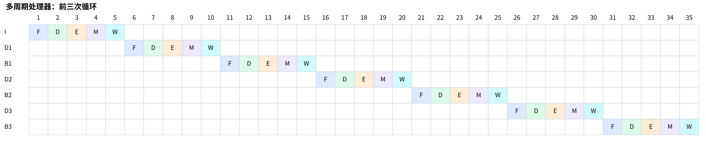
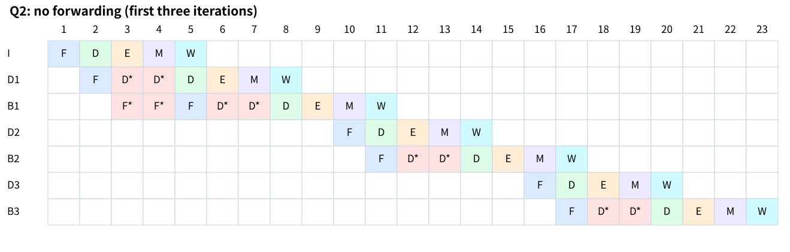
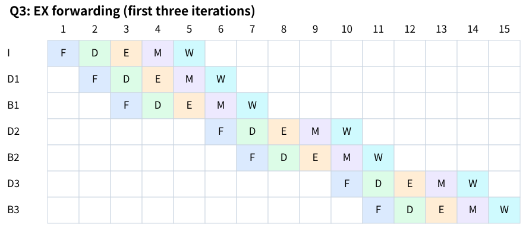
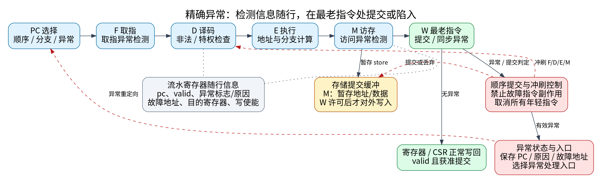
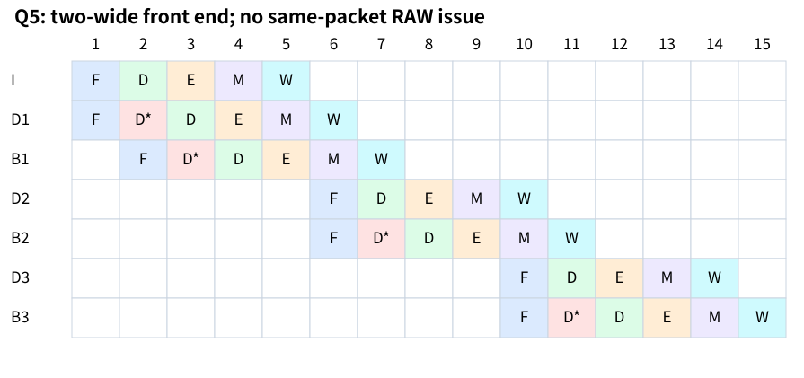
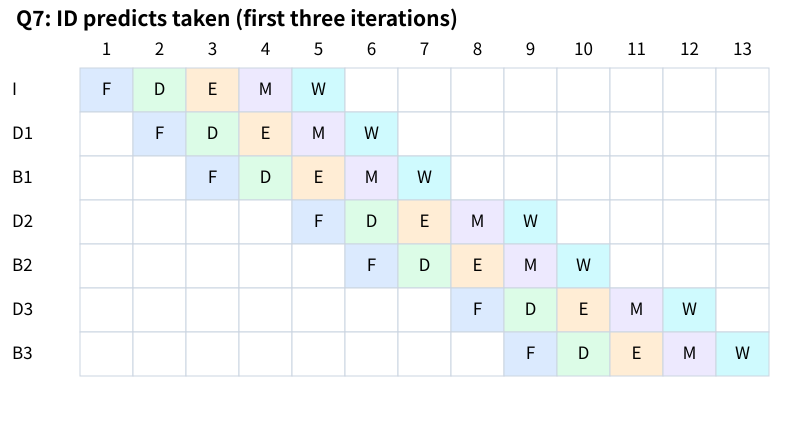

**计算约定：**五级流水线分别为取指 F、译码 D、执行 E、访存 M、写回 W；分支在 E 级末判定。无前递时允许 W 写寄存器与 D 读寄存器在同周期先写后读；含前递时，ALU 结果可前递至下一条指令的 E 级，包括分支比较。除第 7 题外均顺序取指；流水线周期数统一计至末条指令通过 W 级。题目所附图片未包含图 9.4、9.6、9.13、9.18，以下时序按这些约定计算。

# 第 1 题

程序先令 `t0=100`，每次循环减 1，当 `t0=0` 时退出。因此，初始化指令执行 1 次，减一指令和分支指令各执行 100 次，共 201 条指令。前 99 次分支跳转，最后 1 次不跳转。

多周期处理器中，设 `addi.w` 经 F、D、E、W 四个周期完成，`bnez` 经 F、D、E 三个周期完成，则总周期数为

\[
C_1=4+100\times4+100\times3=\boxed{704}.
\]

以下用 I 表示初始化指令，$D_i$ 和 $B_i$ 分别表示第 $i$ 次循环的减一指令和分支指令。前三次循环的时空图如下。



前三次循环结束时为第 25 周期。若多周期处理器对这两类指令采用其他周期数，则应按 $101c_{\mathrm{addi}}+100c_{\mathrm{branch}}$ 重新计算。

# 第 2 题

无前递时，消费者必须等到生产者写回后才能读到新值。以初始化和第一次减一为例，I 在第 5 周期写回，而 $D_1$ 原本应在第 3 周期读寄存器，故需停顿 2 个周期。每对 $D_i$、$B_i$ 之间也有同样的 RAW 相关，各需停顿 2 个周期。

数据相关共增加

\[
C_{\mathrm{data}}=2+100\times2=202
\]

个周期。分支在 E 级末判定，实际跳转时冲刷 F、D 两级，各损失 2 个周期，因此控制相关增加

\[
C_{\mathrm{control}}=99\times2=198
\]

个周期。加上五级流水线的填充和排空时间，总周期数为

\[
C_2=201+4+202+198=\boxed{605}.
\]



图中带星号的格子表示停顿。$B_1$ 在第 9 周期判定跳转，故 $D_2$ 在第 10 周期取指；$B_2$ 在第 15 周期判定跳转，故 $D_3$ 在第 16 周期取指。

# 第 3 题

加入前递后，`addi.w` 在 E 级末产生的结果可以在下一周期送给后续指令的 E 级。因此，初始化与减一、减一与分支之间均不再需要数据停顿。

程序没有 load 指令，不存在 load-use 停顿；但前递不能消除分支重定向的开销。前 99 次跳转仍各损失 2 个周期，所以

\[
C_3=201+4+99\times2=\boxed{403}.
\]



例如，$D_1$ 在第 4 周期算出 99，$B_1$ 在第 5 周期通过前递得到该值并判定跳转，$D_2$ 在第 6 周期取指。

# 第 4 题

精确异常要求：异常指令之前的指令都已完成，异常指令及之后的指令均未对架构状态产生不可撤销的修改，并保存正确的异常返回地址和异常原因。

为此，在五级流水线中增加以下逻辑。

1. **异常信息随行。**各流水寄存器增加 PC、有效位、异常标志、异常原因，以及需要时的故障地址。F 检查取指异常，D 检查非法指令和特权异常，E、M 检查相应的执行或访存异常。
2. **在 W 统一处理。**异常被检测到时先记录，不立即跳入处理程序。等该指令成为 W 级最老指令后，再决定正常提交或产生异常。
3. **控制写使能。**寄存器、CSR 和内存更新都必须满足有效且允许提交。异常指令本身禁止提交，所有年轻指令均被冲刷。
4. **保存异常上下文。**记录故障指令 PC、异常原因和故障地址，再将 PC 切换到异常入口。在 LoongArch 中可使用 ERA、ESTAT、BADV 等相应 CSR。
5. **延迟不可撤销的访存副作用。**store 在 M 级先进入存储提交缓冲，经过异常检查并获得 W 级提交许可后才对外写入；MMIO 等有副作用的访问也要受提交顺序约束。

修改后的结构如下。



若不同指令同时检测到异常，应优先处理程序顺序最老的有效异常。同一指令的异常优先级按指令集规定处理。老分支可以取消错误路径上的年轻异常，老指令的异常也可以取消年轻分支，不能仅按检测时间先后来决定优先级。

以故障 load 为例：它在 M 级检测到访问异常后，将异常信息送到 W；到达 W 时，所有更老指令已经完成。此时禁止该 load 写回，取消年轻指令及其未提交的存储，保存故障 PC 并进入异常处理程序。

中断则应在指令边界接收。简化实现可停止新取指并排空流水线后响应中断，保存继续执行位置，避免把中断返回地址与同步异常的故障指令地址混淆。

# 第 5 题

双发射只能同时发射满足依赖和资源约束的指令，不能简单将指令数除以 2。

本程序中，初始化与第一次减一之间有 RAW 相关，每次减一与紧随的分支之间也有 RAW 相关。若不支持同组两条指令之间的组合级联前递，这些指令就必须分开发射。循环中没有其他独立指令可填入第二条通路，因此有效执行速度与第 3 题相同：

\[
C_5=201+4+99\times2=\boxed{403}.
\]



图中可以同时取回两条指令，但相关指令在 D 级被拆开发射。若图 9.18 允许同组 ALU 结果直接提供给同组分支，或采用更早的分支判定，则应根据其具体通路另行计算。

# 第 6 题

寄存器数据相关主要有以下三种。

| 类型 | 含义 | 示例 |
|---|---|---|
| RAW，写后读 | 后一条指令需要前一条指令产生的值，属于真相关 | `add r1,r2,r3`；`sub r4,r1,r5` |
| WAR，读后写 | 后一条指令不能提前覆盖前一条指令尚未读取的值，属于反相关 | `add r4,r1,r2`；`sub r1,r3,r5` |
| WAW，写后写 | 两条指令写同一寄存器，必须保证最终保留后一条指令的结果，属于输出相关 | `add r1,r2,r3`；`sub r1,r4,r5` |

简单静态五级流水线按序读寄存器、按序写回，通常不会产生 WAR、WAW 冒险。对于 RAW，可通过前递尽早提供结果；结果尚未产生时则停顿。例如，紧邻的 load-use 通常仍需等待一个周期。多发射处理器还需要检查同组指令的相关。

采用寄存器重命名后，同名架构寄存器的不同版本映射到不同物理寄存器，从而消除 WAR、WAW 假相关。RAW 不能通过重命名消除，消费者仍要等待生产者，并利用标签唤醒、发射队列和结果旁路获得操作数。执行可乱序进行，提交则由重排序缓冲区保持程序顺序。

内存地址之间也可能存在数据相关，不能只靠寄存器重命名解决，还需要访存队列、地址消歧、必要的停顿或存储到加载的前递。

# 第 7 题

译码级预测跳转后，分支在 D 级给出目标，下一周期即可取目标指令，无需等到 E 级得到真实判定。前 99 次分支的预测方向均正确，每次跳转损失由 2 个周期降为 1 个周期。

因此，在计至最后一条分支通过 W 的口径下，

\[
C_7=201+4+99\times1=\boxed{304}.
\]



最后一次分支实际不跳转，预测错误。末尾时序为：

| 指令 | F | D | E | M | W |
|---|---:|---:|---:|---:|---:|
| $D_{100}$ | 299 | 300 | 301 | 302 | 303 |
| $B_{100}$ | 300 | 301 | 302 | 303 | 304 |

错误路径上的 $D_{101}$ 在第 302 周期取回，并于该周期末被取消；正确的循环后继指令最早在第 303 周期取指。该恢复不会推迟已经进入流水线的 $B_{100}$ 的 W，因此计算本程序段时不能在 304 上再重复增加后继指令的取指罚时。

若以有架构意义的操作完成为终点，而不要求分支经过 M、W，则第 2、3、5、7 题在本模型下分别为 603、401、401、303 周期。其中第 7 题需等到 $D_{100}$ 在第 303 周期写回。

# 第 8 题

采用循环底部条件回跳，每轮十次循环的分支序列为 $T^9N$。假设三个条件分支分别对应独立的 BHT 项，初始值均为 0，且每次重新进入内层循环时不清空预测状态。一位的 0 预测不跳转，两位的 00 表示强不跳转。

内层循环共被调用 100 次，中层被调用 10 次，外层被调用 1 次。因此总条件分支数为

\[
N_B=100\times10+10\times10+1\times10=1110.
\]

**一位 BHT：**每段 $T^9N$ 的第一个 T 因初始或上次退出留下的 N 状态而预测错误，最后一个 N 也预测错误。每次调用错 2 次，故

\[
E_1=2(100+10+1)=222,
\qquad
A_1=\frac{1110-222}{1110}=\boxed{80\%}.
\]

**两位 BHT：**00、01 预测 N，10、11 预测 T；实际 T 时计数器饱和加一，实际 N 时饱和减一。

第一次调用从 00 开始，前两个 T 预测错误，最后一个 N 也错误，共错 3 次，结束时状态为 10。以后每次从 10 开始，只有退出时的 N 错误。因此，被调用 $r$ 次的循环总共错 $3+(r-1)=r+2$ 次。

\[
E_2=(100+2)+(10+2)+(1+2)=117,
\]

\[
A_2=\frac{1110-117}{1110}
=\frac{331}{370}\approx\boxed{89.4595\%}.
\]

| 循环 | 分支次数 | 一位误判次数 | 两位误判次数 |
|---|---:|---:|---:|
| 内层 | 1000 | 200 | 102 |
| 中层 | 100 | 20 | 12 |
| 外层 | 10 | 2 | 3 |
| 合计 | 1110 | 222 | 117 |

这里保留了全零初始状态的冷启动误判，不能直接将两位预测器的稳态准确率 90% 作为精确答案。

高级语言的 `for` 也可能被翻译为循环顶部检查。若每次分支序列为“条件成立跳入循环体”的 $T^{10}N$，则总分支数为 1221，误判数仍分别为 222、117，准确率分别为 81.8182%、90.4177%。具体应与采用的汇编分支形式一致。

# 第 9 题

Cache 块大小为 64 B，所以块内偏移为

\[
b_{\mathrm{Offset}}=\log_2 64=6.
\]

Cache 总块数为

\[
\frac{32\times1024}{64}=512.
\]

$w$ 路组相联的组数为 $512/w$，Index 位数为 $\log_2(512/w)$，其余地址位为 Tag。因此：

| 组织方式 | 组数 | Tag | Index | Offset |
|---|---:|---:|---:|---:|
| 直接映射 | 512 | 17 位 | 9 位 | 6 位 |
| 两路组相联 | 256 | 18 位 | 8 位 | 6 位 |
| 四路组相联 | 128 | 19 位 | 7 位 | 6 位 |

各字段的地址位置如下：

```text
直接映射：   Tag[31:15]  Index[14:6]  Offset[5:0]
两路组相联： Tag[31:14]  Index[13:6]  Offset[5:0]
四路组相联： Tag[31:13]  Index[12:6]  Offset[5:0]
```

同组中具体命中哪一路由 Tag 比较确定，不需再从地址中划出路号位。

# 第 10 题

设两方案不含数据 Cache 不命中停顿的基础 CPI 均为 $C_0$，方案一的主频为 $f$，则方案二的主频为 $0.9f$。

两方案的平均 CPI 分别为

\[
CPI_1=C_0+0.4\times(1-0.85)\times100=C_0+6,
\]

\[
CPI_2=C_0+0.4\times(1-0.95)\times100=C_0+2.
\]

由执行时间 $T=IC\times CPI/f$，且两方案的动态指令数相同，有

\[
\frac{T_2}{T_1}=\frac{C_0+2}{0.9(C_0+6)}.
\]

按理想基础 $C_0=1$ 计算，

\[
CPI_1=7,\qquad CPI_2=3,
\]

\[
\frac{T_2}{T_1}=\frac{3}{0.9\times7}=\frac{10}{21},
\qquad
\frac{T_1}{T_2}=\boxed{2.1}.
\]

因此方案二性能更优，其执行时间约为方案一的 47.62%，即性能为方案一的 2.1 倍。

题目未给出基础 CPI，若保留一般形式，则方案二更优的条件是

\[
C_0+2<0.9(C_0+6)\iff C_0<34.
\]

当 $C_0=34$ 时两者相同，$C_0>34$ 时则方案一更优。
