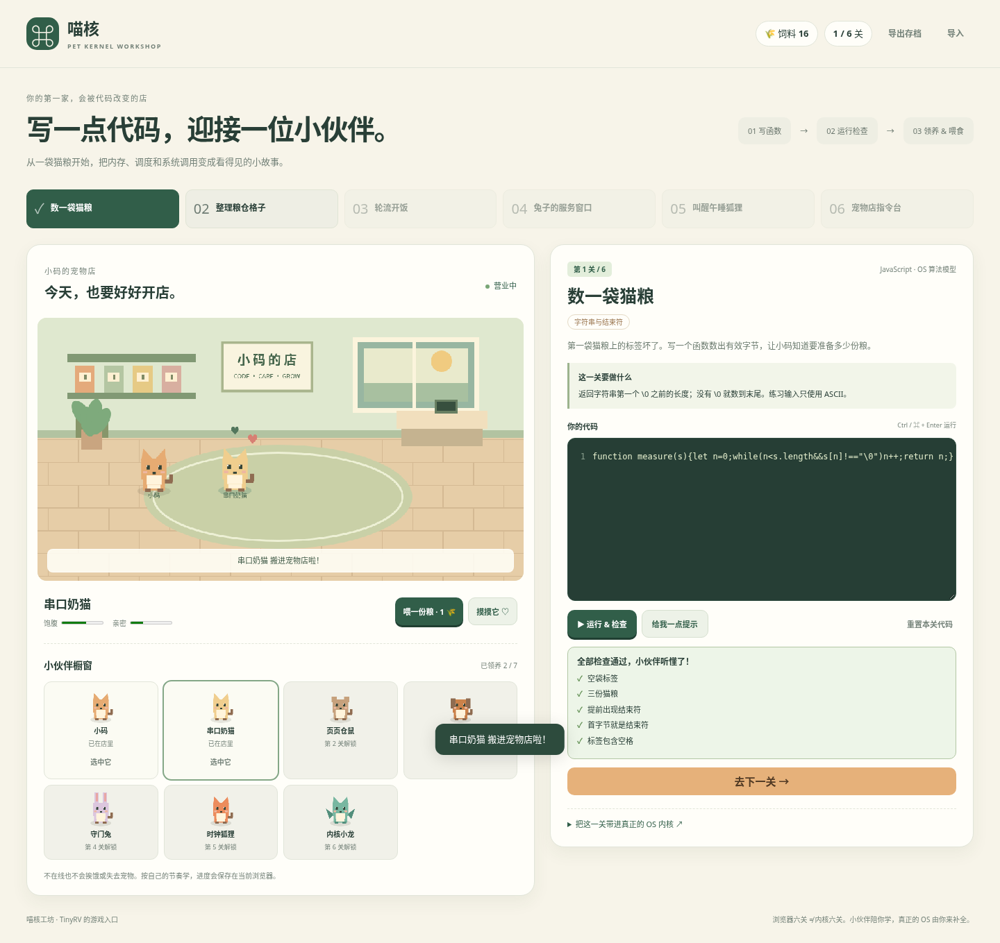

# 喵核宠物工坊：把写 OS 变成经营宠物店

写对一小段函数，解锁一只宠物，获得饲料，再到真实内核里实现对应能力。灵感是编程闯关与宠物经营；内容、画面和代码是本项目独立实现。



## 怎么玩

1. 打开本目录的 `index.html`。也可以在 Codespaces 中从仓库根目录运行 `python3 -m http.server 8000 --directory os-lab/game`，通过 **Ports** 面板打开 8000 端口。
2. 从第一关开始，阅读目标，在编辑器中补全指定函数。
3. 点击 **运行 & 检查**，或按 Ctrl/⌘+Enter。检查的是函数在多个输入下的真实返回值和状态变化；不是查找关键词。
4. 首次通过一关获得 8 份饲料并解锁宠物；在橱窗点击 **领养**，再点击 **喂一份粮** 或 **摸摸它**。重复通过可获得 2 份饲料。
5. 点 **去下一关**。完成粮仓、服务窗口和时钟关卡，店内也会出现新的设施。

宠物没有离线饥饿惩罚，不会死亡或丢失。存档包含代码草稿和宠物状态，保存在当前浏览器；换设备前使用导出/导入存档。无效导入不会覆盖当前进度。

## 六关与真正的 C 内核

| 游戏关卡 | 练习的核心思路 | 对应 C 文件 |
| --- | --- | --- |
| 数一袋猫粮 → 串口奶猫 | 字符串长度、NUL 结束符 | `../exercises/01_strings.c` |
| 整理粮仓 → 页页仓鼠 | 空闲标记、分配后更新状态 | `../exercises/02_pages.c` |
| 轮流开饭 → 轮转柯基 | READY 筛选、循环选择 | `../exercises/03_scheduler.c` |
| 服务窗口 → 守门兔 | 调用号、合法参数、错误码 | `../exercises/04_syscall.c` |
| 叫醒狐狸 → 时钟狐狸 | 到期时刻和边界条件 | `../exercises/05_timer.c` |
| 指令台 → 内核小龙 | 命令词和参数解析 | `../exercises/06_shell.c` |

**游戏运行的是 JavaScript 算法模型，不是在浏览器里编译 C 或模拟 RISC-V。** 每关下面的“带进真正的 OS 内核”会指向对应文件，并提供 `make check LAB=N`。例如第五关模型只练习到期判断，真实第五关还要初始化硬件定时器、中断并验证抢占。

在 Codespaces 中补全 C 文件后，用 QEMU 单独验收，才能证明真正的内核能力已经完成。游戏过关和内核过关是两条清楚区分的进度；网页不会自动声称你的 C 实现已经通过。

## 页面与开发

纯静态单文件页面，无账号、服务器 API 或第三方素材依赖。代码在一次性 Web Worker 中运行；超过 1.2 秒会停止这次执行，避免错误循环卡住页面。加载完成后断网也能继续练习。部分受管理浏览器会禁止 `file://`，此时使用上面的本地 HTTP 服务或 GitHub Pages。

```bash
cd os-lab/game
node build.mjs                       # src/ → 独立 index.html
node build.mjs --check               # 检查生成页面没有过期
node --test tests/engine.test.cjs     # 不需要 npm install
```

浏览器开发测试另外需要 Playwright 和 Chromium，在安装好它们的环境执行 `node tests/browser.cjs`。该测试走实际页面：错误答案、死循环超时、六关成功、领养、喂食、刷新存档、导入导出、手机布局及断网运行。

源代码：`src/engine.js` 是关卡/检查/经营规则；`src/app.js` 是交互与像素店铺；`src/style.css` 是布局；`src/template.html` 是页面结构。修改后重新 build，提交源代码与生成的 index.html。

## GitHub 上打开

仓库已有的 **Deploy OS Quest to GitHub Pages** 工作流会保留原复习游戏首页，同时将本游戏放在 `/pet-kernel/` 子目录。

如果 Pages 使用默认项目域名，部署成功后地址是：

```text
https://zxymao.github.io/Chatgpt/pet-kernel/
```

是否已发布以 Actions 工作流结果及仓库 **Settings → Pages** 为准。若尚未启用 Pages，在该页选择 GitHub Actions 作为来源，再手动运行工作流。也可以直接下载本目录 `index.html` 使用。
